  

  

<h3 align="center">Rascal's moves</h3>

  

  Rascal lives on my desktop, inside my <a href="https://quickshell.org">Quickshell</a> config. Every frame on this page comes from its own sprite code.

  

<!-- Proudly created with GPRM ( https://gprm.itsvg.in ) -->
